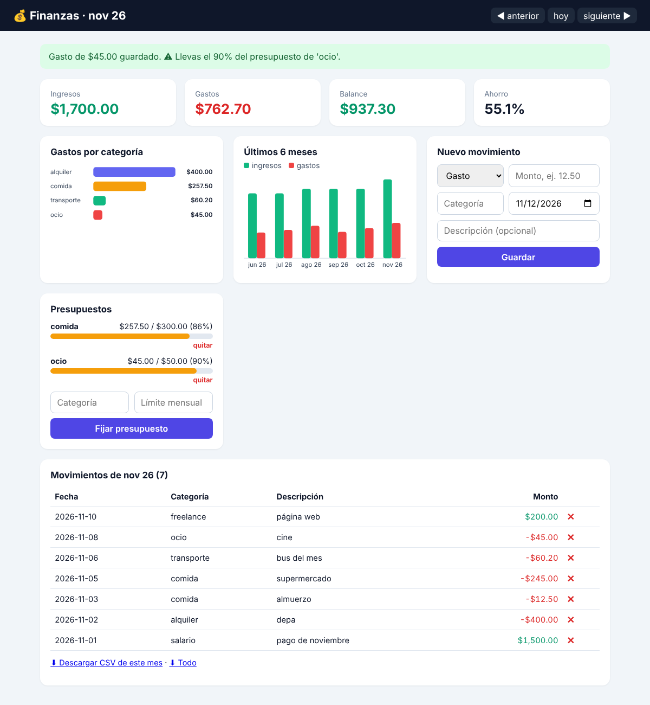

# 💰 finanzas-cli

[](https://github.com/luiss-devON/finanzas-cli/actions/workflows/tests.yml)


Controla tus **gastos, ingresos y presupuestos** desde la terminal o desde un **panel web con gráficos**. Registra un gasto en 2 segundos, mira en qué se te va el dinero con gráficos de barras y recibe avisos cuando estás por pasarte de tu presupuesto.

Tus datos son tuyos: se guardan en un archivo SQLite local, sin cuentas ni nube.

## ✨ Características

- **Panel web** (`finanzas web`): tarjetas de balance, gráfico de gastos por categoría, tendencia de 6 meses, presupuestos con barras de progreso, formularios y descarga CSV.
- **Registro rápido**: `finanzas gasto 12.50 comida almuerzo`
- **Resumen mensual**: ingresos, gastos, balance, % de ahorro y gráfico por categoría.
- **Presupuestos** por categoría con avisos al 80 % y al excederlos.
- **Tendencia** de los últimos N meses.
- **CSV**: exporta para Excel/Google Sheets e importa extractos (acepta `,` o `;`, `12.50` o `12,50`).
- **Dinero exacto**: montos guardados como enteros en centavos, nunca `float` (0.1 + 0.2 = 0.30 siempre).
- **Sin dependencias**: solo la biblioteca estándar de Python. Funciona en Windows y Linux.

> ⚠️ **macOS: no funciona por ahora.** Solo está probado y soportado en Windows y Linux.

## 📦 Instalación

```bash
git clone https://github.com/luiss-devON/finanzas-cli.git
cd finanzas-cli
pip install .
```

## 🚀 Uso

```bash
finanzas ingreso 1500 salario "pago de noviembre"
finanzas gasto 12.50 comida almuerzo
finanzas gasto 3,20 transporte bus --fecha 2026-11-03

finanzas presupuesto fijar comida 300
finanzas presupuesto ver

finanzas listar                 # movimientos del mes actual
finanzas listar --todo --categoria comida
finanzas resumen --mes 2026-11
finanzas tendencia --meses 6

finanzas exportar respaldo.csv
finanzas importar extracto_banco.csv
finanzas borrar 7

finanzas web                    # abre el panel en el navegador
finanzas web --puerto 8080 --no-abrir
```

Ejemplo de `finanzas resumen`:

```text
Resumen de 2026-11
══════════════════════════════════════════════
  Ingresos :        $1,500.00
  Gastos   :          $642.30
  Balance  :          $857.70
  Ahorro   :            57.2%

Gastos por categoría
──────────────────────────────────────────────
  alquiler     ████████████████████████      $400.00  62.3%
  comida       ███████████░░░░░░░░░░░░░      $182.10  28.4%
  transporte   ████░░░░░░░░░░░░░░░░░░░░       $60.20   9.4%

Presupuestos de 2026-11
──────────────────────────────────────────────
  comida       ███████████████░░░░░░░░░ $182.10 / $300.00 (61%)
```

### 🌐 Panel web

`finanzas web` abre `http://127.0.0.1:8000` en tu navegador:




- Ingresos, gastos, balance y % de ahorro del mes.
- Gráfico de gastos por categoría y de ingresos vs. gastos de los últimos 6 meses (SVG, sin librerías externas).
- Formulario para registrar movimientos y fijar presupuestos, con avisos al 80 % y al excederlos.
- Tabla de movimientos con botón para borrar y navegación entre meses.
- Descarga en CSV del mes o de todo.

**Seguridad**: el servidor solo escucha en tu propio equipo (`127.0.0.1`), rechaza encabezados `Host` extraños (protección contra *DNS rebinding*), exige un token secreto en cada formulario (protección CSRF), escapa todo el texto (sin XSS) y envía una política `Content-Security-Policy` estricta.

### Formato CSV para importar

```csv
fecha,tipo,monto,categoria,descripcion
2026-11-01,ingreso,1500.00,salario,pago mensual
2026-11-02,gasto,12.50,comida,almuerzo
```

Las filas con errores se informan con su número de línea y no detienen la importación del resto.

### ¿Dónde se guardan los datos?

Por defecto en `~/.finanzas/finanzas.db`. Puedes cambiarlo con `--db archivo.db` o la variable de entorno `FINANZAS_DB` (útil para tener varias cuentas o un archivo dentro de Dropbox/OneDrive).

## 🧪 Tests

```bash
python -m unittest -v
```

## 🗂️ Estructura

```text
src/finanzas/
├── money.py    # lectura/formato de montos en centavos (Decimal)
├── store.py    # capa de datos SQLite (consultas parametrizadas)
├── report.py   # resúmenes y gráficos de barras en texto
├── csvio.py    # importación/exportación CSV
├── web.py      # panel web local (http.server + gráficos SVG)
└── cli.py      # interfaz de línea de comandos (argparse)
tests/          # 24 tests con unittest
```

## 📄 Licencia

MIT
